# C4 Components — Journal Management System

Level 2: components of the Laravel monolith and the supporting
containers it uses. Behavior is specified by the test suite; this
document maps the codebase structure.

```mermaid
flowchart TB
    subgraph client["Web Browser"]
        ui["Tailwind + Alpine.js UI<br/>Vite build"]
        livewire["Livewire (Filament)"]
    end

    subgraph app["Journal System — Laravel Monolith"]
        direction TB
        subgraph publicsite["Public Site (anonymous)"]
            pub[Home / Issues / Articles<br/>PDF, BibTeX/RIS/JATS]
            cms[CMS Pages, Policies,<br/>Events, Conferences]
            search[Search]
            oai[OAI-PMH Endpoint]
        end

        subgraph dashboard["Dashboard /dashboard (permission-gated)"]
            submissions[SubmissionController<br/>submit, revise, files]
            reviews[ReviewController<br/>reviewer workspace]
            editorial[EditorialController<br/>assign, decide, publish, retract]
            inbox[DashboardController<br/>inbox, watchlist, deadlines]
            discussions[DiscussionController<br/>scoped threads]
        end

        subgraph admin["Filament Admin /admin (admin role)"]
            fil[12 resources: Articles, Issues, Categories,<br/>Authors, Reviews, Users, Pages, Events,<br/>Conferences, Organizations, Copyright<br/>Agreements, OutboxEvent log, System Health]
        end

        subgraph domain["Domain Core (app/Models)"]
            article[Article workflow:<br/>status machine, rounds, galleys]
            review[Review lifecycle:<br/>pending → completed/declined/cancelled]
            author[Author & ORCID claim]
            discussion[Discussion, ResponseLetter]
            outbox[OutboxEvent audit log]
        end

        subgraph authz["Authorization"]
            spatie[Spatie roles & permissions]
            policies[Policies: Article, Review,<br/>Discussion, ArticleFile, ResponseLetter]
        end

        subgraph services["Integration Services"]
            doi[Doi: DoiMinter,<br/>CrossrefXmlBuilder, CrossrefClient]
            jats[Jats: JatsXmlBuilder,<br/>HtmlToJatsConverter]
            oaisvc[Oai: record query,<br/>signed resumption tokens]
            support[Support: DashboardInbox/Watchlist,<br/>DecisionLetter, ReviewerMatcher, Stats]
        end

        subgraph background["Background"]
            job[DepositArticleToCrossref job]
            notif[17 notifications<br/>+ queued mailables]
            commands[Commands: sitemap, robots,<br/>review reminders, crossref backfill/redeposit]
        end
    end

    subgraph containers
        db[(PostgreSQL<br/>+ queue tables)]
        localdisk[("Private local disk:<br/>manuscripts, blinded, galley,<br/>response letters")]
        pubdisk[("Public disk:<br/>supplementary files, thumbnails")]
    end

    crossref["Crossref API"]
    smtp["SMTP"]

    ui --> publicsite & dashboard
    livewire --> fil
    publicsite & dashboard & admin --> authz
    dashboard & admin --> domain
    publicsite & dashboard --> domain
    domain --> db
    article & submissions --> localdisk
    fil --> pubdisk
    editorial & job --> doi
    publicsite --> jats
    oai --> oaisvc
    dashboard --> support
    domain --> outbox --> db
    notif --> smtp
    job --> crossref
    commands --> job & notif
```

## Component notes

| Component | Location | Responsibility |
|---|---|---|
| Public site | `app/Http/Controllers/*` (non-Dashboard) | Read-only surface: published content, exports, OAI-PMH, sitemap; gates manuscript files through policies |
| Submission | `Dashboard/SubmissionController` | Manuscript submission, duplicate-title warning with a session-parked PDF, revision with response letter, galley approval, withdrawal |
| Reviewer workspace | `Dashboard/ReviewController` | Invitation accept/decline, review completion; manuscript and response-letter access only for active assignments |
| Editorial desk | `Dashboard/EditorialController` | Editor/reviewer assignment (single and bulk, COI-guarded), decisions, copyediting, production, publishing, retraction, corrections |
| Dashboard home | `Dashboard/DashboardController` + `Support/DashboardInbox`, `DashboardWatchlist` | Role-aware task inbox, watchlist and review deadlines, computed round-aware |
| Discussions | `Dashboard/DiscussionController` + `DiscussionPolicy` | Scope-based threads (article/editorial), review-bound reviewer participation while active |
| Filament admin | `app/Filament/Resources` | Full CRUD for reference data, users, agreements, issues; outbox event log; system health (queue, failed jobs, Crossref status) |
| Domain core | `app/Models` | Workflow state machines and transactions; every state change writes an `OutboxEvent` with an attribute snapshot and actor |
| Authorization | `app/Policies`, Spatie | Route middleware `permission:*` + row-level policies; COI deny-side via `Article::isAuthoredBy` (claimed link or pivot email) |
| DOI/Crossref | `app/Services/Doi` | Opaque-suffix DOI minting, XML 5.3.1 building with Crossmark updates and FundRef, deposit client with retries |
| JATS / OAI | `app/Services/Jats`, `app/Services/Oai` | HTML→JATS conversion and export; stateless signed resumption tokens, tombstones for soft-deleted records |
| Background | `app/Jobs`, `app/Notifications`, `app/Console/Commands` | Queued Crossref deposits and mail; sitemap/robots generation; review reminders; Crossref backfill and re-deposit |

## Storage & data containers

- **PostgreSQL** — domain data, Spatie permission tables, queue jobs,
  failed jobs, notifications, outbox events.
- **Private local disk** — original manuscripts, blinded PDFs, galley
  proofs, copyedited files, response-letter attachments. Never exposed
  by URL; streamed via authorized controller responses.
- **Public disk** — supplementary article files with public access
  level and generated thumbnails.
