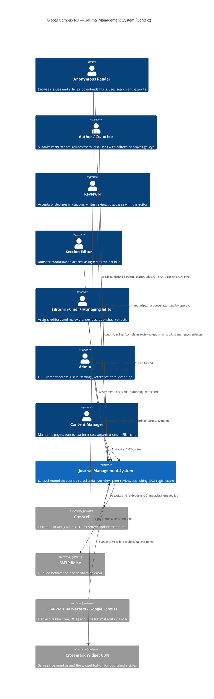

# C4 Context — Journal Management System

Level 1: the journal system as a black box, its users, and the external
systems it talks to. The single source of truth for behavior is the test
suite (see `tests/Feature/`); this document describes structure only.

## System responsibilities

- **Public site** — published issues and articles, PDF downloads, search,
  exports (BibTeX/RIS/JATS), CMS pages, events, conferences, OAI-PMH.
- **Peer review** — round-based review lifecycle with blind-review
  support, reviewer invitations and re-requests, response letters.
- **Editorial workflow** — assignment (single and bulk with
  conflict-of-interest guards), decisions, copyediting, production,
  galley approval, issue publishing, retraction and corrections.
- **Publishing infrastructure** — DOI minting and Crossref deposits,
  Crossmark updates, article statistics, indexing (sitemap, Scholar
  meta tags).

## Trust boundaries

- Everything under `/dashboard/*` is authenticated, permission-gated
  and email-verified; row-level access is enforced by policies.
- The Filament panel at `/admin` is admin-only, except content-manager
  resources restricted by `canAccess`.
- Manuscript files live on a private disk and are streamed through
  authorization-checked controller actions, never by public URL.
